# Project HIVE: Honeypot and AI-Based Intrusion Detection on Azure

Project HIVE is a honeypot on Microsoft Azure that collects real attacks from the internet and uses machine learning to point out the attackers worth a closer look. It was a four-person team project for ITEC 4810 (IT Project) at Georgia Gwinnett College in Fall 2026, built over three sprints from September to October.

I was the team's **Cloud and Security Lead**. I built and secured the Azure environment, ran data collection, set up the log storage, and owned the security review and cost control. My part is covered in detail under [My role](#my-role-cloud-and-security-lead).

We are presenting the project as a poster at GGC's 27th CREATES Conference on November 13, 2026.

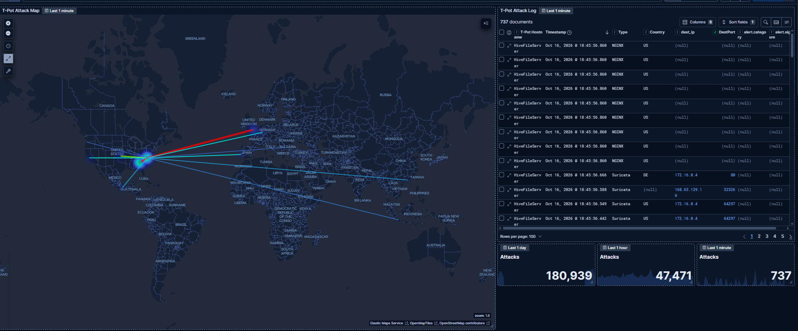
*Live view from the dashboard: 180,939 attacks in the last day and 47,471 in the last hour.*

## At a glance

| Area | Details |
|---|---|
| Honeypot platform | T-Pot 24.04.1: 20+ honeypots plus the Suricata IDS, running in Docker |
| Cloud | Microsoft Azure, Standard_D4s_v3 VM, Ubuntu Server 24.04 LTS, East US 2 |
| Traffic in one 24-hour window | 360,864 attack events from 5,635 IP addresses in 67 countries |
| Detection model | Isolation Forest (scikit-learn) on 5 behavior features per attacker |
| Scoring | Automatic, every 5 minutes, results shown in Kibana |
| Model output, Oct 5 to 15 | 26,026 attacker windows scored, 515 flagged for review |
| Azure cost, Oct 1 to 15 | $23.11 |

## How it works

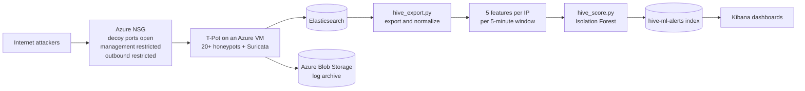

Attackers reach the decoy services through ports the network security group leaves open on purpose. T-Pot logs everything to Elasticsearch, and a copy of the logs goes to a separate storage account. Every 5 minutes a Python job pulls the new events, turns each attacker's activity into five numbers, scores them with the model, and writes the results back to Elasticsearch, where Kibana shows them next to the raw attack data.

## My role: Cloud and Security Lead

I owned the Azure side of the project and its security and cost controls, which came to 16 of the team's 56 tasks in the final project plan. Our original design had me on networking only. In practice I built the whole Azure environment, and we updated the plan to match.

**Sprint 1: a server that is supposed to get attacked.** I provisioned the resource group, virtual network and subnet, created the Standard_D4s_v3 VM with Ubuntu Server 24.04 LTS, and gave it a static public IP. The interesting part was the network security group. A honeypot needs its decoy ports open to the whole internet, so inbound ports 1 to 64000 are allowed, while T-Pot's management ports stay restricted. I also restricted outbound traffic, because the real danger with a honeypot is an attacker breaking out of a decoy and using your server to attack someone else.

**Sprint 2: collecting data and protecting the logs.** I ran the first two collection windows and re-ran the security test to confirm the outbound restriction held. I set up a dedicated storage account so the honeypot logs live outside the VM, and locked it down from day one. I also enabled Network Watcher in the region as the base for traffic flow monitoring. Watching storage ingress is how I spotted that collection stopped for about five hours on October 6, which taught me that a gap in the chart is a gap in the training data.

**Sprint 3: security review and cost control.** I wrote the security review and incident runbook, reviewed our threat model, audited the NSG rules, and ran collection windows 3 and 4. On the cost side I set up a monthly budget with an alert in Azure Cost Management, reconciled spending by service, went through Azure Advisor, and wrote the teardown plan. I also handled the final documentation, the repository and our presentation rehearsal.

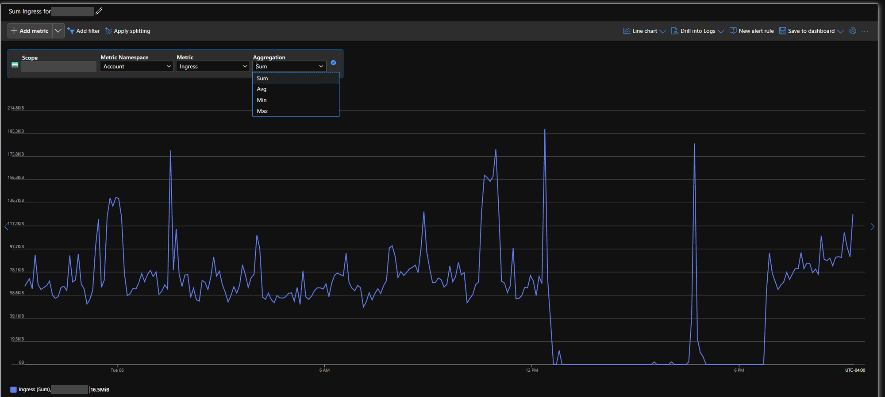
*Logs flowing into the storage account: 16.5 MiB in 24 hours, usually 40 to 120 KiB every 5 minutes, with the flat stretch on October 6 where collection stopped.*

### Security controls I put in place

| Control | Why |
|---|---|
| Inbound ports 1 to 64000 open to the internet | A honeypot only works if attackers can reach the decoys |
| T-Pot management ports restricted | Admin access should never be part of the attack surface |
| Outbound traffic restricted | If someone breaks out of a decoy, the VM can't be used to attack other systems |
| Logs copied to a separate storage account | The evidence survives even if the VM is compromised or deleted |
| Shared key and anonymous access disabled | Every storage request has to be authorized through Microsoft Entra ID, and nothing is readable anonymously |
| Secure transfer required, TLS 1.2 minimum | No unencrypted or old-TLS connections to the logs |
| Blob versioning and 30-day soft delete | Deleted or overwritten logs can be recovered |
| Storage network access limited to selected networks | The storage endpoint isn't open to the whole internet |
| Monthly budget with an alert | Overspending gets caught automatically |
| Written teardown plan | Nothing keeps running and billing after the project ends |

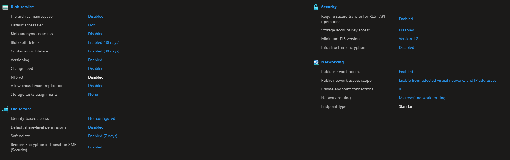

### Cost control

| Service | Cost, Oct 1 to 15 |
|---|---|
| Storage | $15.90 |
| Virtual machines | $5.44 |
| Virtual network | $1.77 |
| Bandwidth | under $0.01 |
| Network Watcher | $0.00 |
| **Total** | **$23.11** |

A Standard_D4s_v3 costs $0.192 an hour, about $140 a month if it never shuts off. We ran the honeypot in collection windows and deallocated the VM in between, which kept compute to about 28 hours ($5.44) in the first half of October and saved roughly $64.

The budget alert still fired on October 12, when actual cost hit $19.38 against a $19 monthly budget, and that was the most useful cost lesson of the project for me. Deallocating a VM stops compute billing, but the managed disk, the storage account and the static public IP keep billing whether the VM is on or off. Storage ended up costing almost three times as much as compute, so in a burst-collection design the fixed costs set the floor, and $19 was too tight for a full month.

Azure Advisor showed every cost and security recommendation already followed. Reliability scored 68% and operational excellence 71%, and the open items there are redundancy features a single test honeypot doesn't need.

The teardown plan has four steps: export the dataset, code and dashboards to GitHub, deallocate the VM, delete the resource group (VM, disk, network and storage), and confirm the daily cost reaches $0.

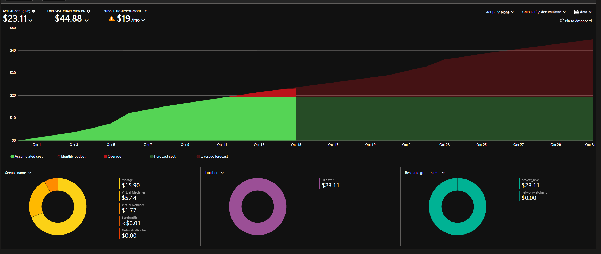

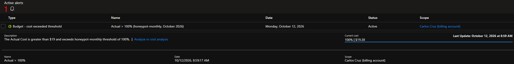

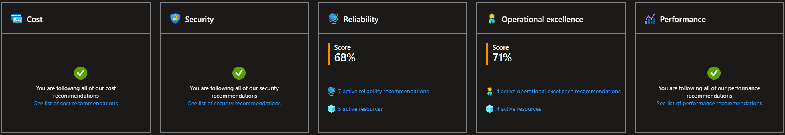

## The detection pipeline (team work)

**Export and normalize, by Nigel Tobella.** `hive_export.py` pulls T-Pot logs out of Elasticsearch for any time range. It drops private and Azure addresses and anything aimed at T-Pot's management ports (64294 to 64299), so our own logins never count as attacks, then maps 15 different log sources into the same 13 columns.

**Features, by Isreal (Ayomide) Ajidahun.** Events are grouped per attacker IP per 5-minute window into five numbers:

| Feature | What it measures |
|---|---|
| `event_count` | how much the attacker did |
| `unique_ports` | how many ports they tried |
| `failed_logins` | how many wrong passwords |
| `unique_usernames` | how many accounts they guessed |
| `commands_count` | what they typed after getting in |

**Model, built by Isreal and retrained by Nigel.** An Isolation Forest with 200 trees and 2% contamination. It builds random trees that try to isolate each row, and attackers who behave unlike everyone else get isolated in just a few cuts, so they score high. It's unsupervised, which meant it could run before any traffic was labeled. The final model was trained on 26,055 rows built from 446,402 attack events captured in collection windows between October 5 and 15.

**Scoring and automation, by Nigel.** `hive_score.py` runs from cron every 5 minutes, with a lock so two runs never overlap. Each result gets a fixed ID made from the time window and the IP, so re-scoring overwrites instead of creating duplicates. Results go to the `hive-ml-alerts` index with an AI score from 0 to 1, an anomaly flag, a severity, an attack type, the source country and the honeypots hit.

| Severity | AI score needed |
|---|---|
| Low | 0.685 (the model's cut-off) |
| Medium | 0.725 |
| High | 0.785 |
| Critical | 0.855 |

The first thresholds marked 122 of 515 anomalies as critical, which is too many to act on. Raising each level on real traffic and re-scoring brought critical down to 81, leaving only the SSH brute-forcers. The model says how unusual an attacker is, not what kind of attack it is, so simple rules on the logs add the attack type (brute force, port scan, web attack, post-login commands, exploit attempt).

**Dashboards, by Brandon Taylor.** One Kibana dashboard holds the live attack map and counters, a section per honeypot, and an AI Intrusion Detection section with anomaly counts, average score, color-coded severity tiles and a security alerts table, all fed by `hive-ml-alerts`. We used Kibana instead of the two custom web pages in our original plan because it already had the data, maps and filters, and it meant one less system to host and secure.

Isreal also built an AbuseIPDB reputation lookup and worked on hand-labeling, a rule-based baseline and a Random Forest comparison.

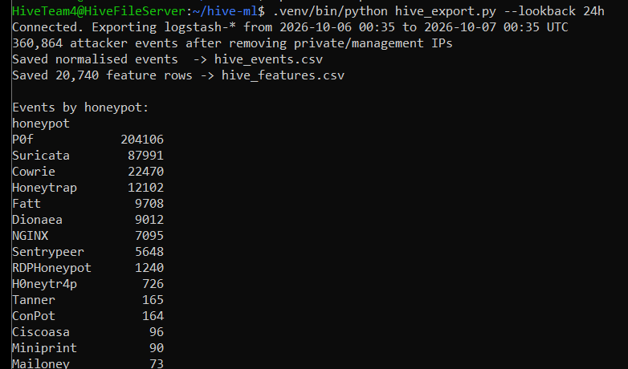

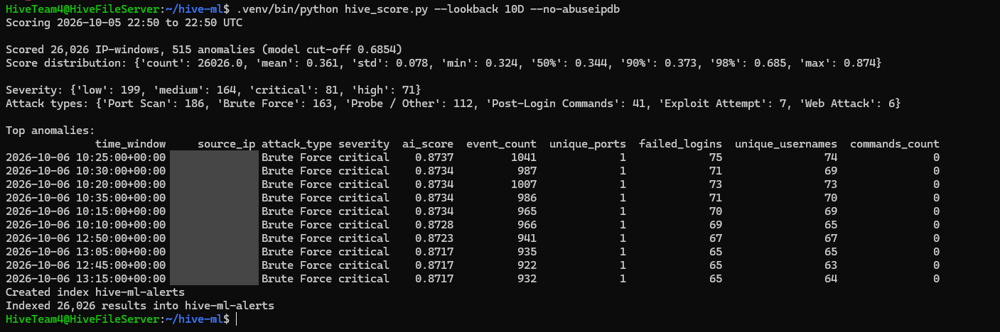

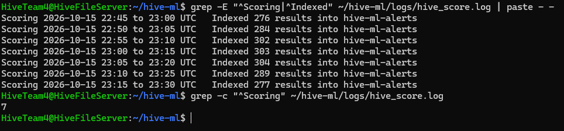

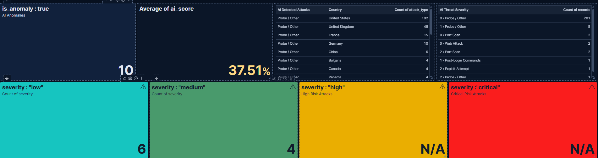

## Results

### What the honeypot saw

In one 24-hour export (October 6 to 7, UTC), after removing our own traffic and private addresses, the honeypot logged 360,864 events from 5,635 IP addresses in 67 countries.

| Source | Events |
|---|---|
| P0f (passive OS fingerprinting) | 204,106 |
| Suricata (network IDS) | 87,991 |
| Cowrie (SSH and Telnet) | 22,470 |
| Honeytrap (listens on any port) | 12,102 |
| Fatt (network fingerprinting) | 9,708 |
| Dionaea (malware capture) | 9,012 |
| NGINX | 7,095 |
| Sentrypeer (SIP / VoIP) | 5,648 |
| RDPHoneypot | 1,240 |
| Others (H0neytr4p, Tanner, ConPot, Ciscoasa, Miniprint, Mailoney and more) | 1,492 |

P0f and Suricata are passive sensors, not honeypots, and together they produced 81% of all events. That's one reason raw event volume says little on its own about how dangerous an attacker is.

Cowrie logged 4,289 failed logins and 44 successful ones in that window. The most-tried login was `root` / `123456`, and the files attackers dropped included redtail, a cryptominer built for four CPU types.

Over roughly the previous month, as of early October, Kibana showed:

| Honeypot | Attacks | Unique IPs |
|---|---|---|
| Cowrie (SSH and Telnet) | 43,596 | 240 |
| Honeytrap (any port) | 21,574 | 4,655 |
| Dionaea (malware capture) | 9,424 | 211 |
| Conpot (industrial / SCADA) | 244 | 69 |
| Mailoney (SMTP) | 118 | 26 |

Honeytrap saw almost 20 times as many unique IPs as Cowrie, but Cowrie took twice as many attacks. Scanners spray the whole internet, while brute-forcers pick a target and keep hammering it.

### What the model flagged

The model scored 26,026 attacker windows from October 5 to 15. Half of them scored 0.344 or lower and 90% scored 0.373 or lower, so the 515 windows above the 0.685 cut-off really stand out.

| Attack type | Flagged |
|---|---|
| Port scan | 186 |
| Brute force | 163 |
| Probe / other | 112 |
| Post-login commands | 41 |
| Exploit attempt | 7 |
| Web attack | 6 |

| Severity | Flagged |
|---|---|
| Low | 199 |
| Medium | 164 |
| High | 71 |
| Critical | 81 |

The top score, 0.874, went to an address that sent 1,041 events in a single 5-minute window, including 75 failed SSH logins across 74 different usernames, and kept that pace for at least half an hour. A neighboring address in the same /24 ran the same pattern about two hours later.

## Challenges and what we learned

| Problem | Fix | Owner |
|---|---|---|
| T-Pot's installer failed while restarting SSH. Azure's Entra ID login had already added a `Match User` block to `sshd_config`, and T-Pot appended its SSH port at the end of the file, inside that block. | Moved the `Port` line to the global section, fixed a missing newline in the `aad_admins` sudoers file, validated with `sshd -t` and `visudo -c`, and kept a second SSH session open before restarting. The sudoers problem came back in Sprint 3 when Azure rewrote the file. | Nigel |
| Our ML teammate had nothing to work on in Sprint 1 because no data existed yet. | Moved the data pipeline work forward from Sprint 3 into Sprint 2. | Team |
| The feature script dropped every IP starting with 172, but only 172.16 to 172.31 is private, and real attackers use other 172 ranges. | Switched to Python's `ipaddress` checks. | Nigel |
| Matching the phrase "login attempt" also counted Cowrie's successful logins as failures. | Used Cowrie's own `cowrie.login.failed` event ID. | Nigel |
| Our own SSH and Kibana sessions were showing up as attacks. | Excluded all traffic to T-Pot's management ports. | Nigel |
| Code written for the Elasticsearch 8 client was rejected by T-Pot's Elasticsearch 9.3.5. | Checked the server version first, then pinned the 9.x client. | Nigel |
| Storage ingress dropped to zero for about five hours on October 6. | A gap in collection is a gap in the training data, so collection windows need the VM up from start to finish. | Carlos |
| An export after a break found only 40 events in 48 hours because the VM had been off. | Checked which days Elasticsearch still held and retrained on all of them. | Nigel |
| The $19 monthly budget was crossed on October 12. | The alert caught it. We kept the VM deallocated outside collection and demo windows, and I learned that fixed costs set the floor. | Carlos |
| 122 of 515 anomalies were rated critical. | Tuned the severity thresholds on real traffic, bringing critical down to 81. | Nigel |

Our three team takeaways:

1. **Read what the platform already configured.** A managed cloud image is not a blank OS. Azure's own settings caused our first install failure and came back in Sprint 3.
2. **Real data finds the real problems.** The IP filter bug, the login counting and our own traffic only showed up in live logs.
3. **Plan around dependencies, not job titles.** Moving data work forward kept all four of us busy every sprint.

## Limitations and next steps

The Isolation Forest ranks how unusual an attacker is. With contamination set to 2%, it flags about 2% of windows by design, and since everything that touches a honeypot is hostile anyway, it works as a triage tool for deciding what to look at first, not as a benign-versus-malicious classifier. Attack types come from rules on the logs rather than from the model. We also collected in windows instead of running the honeypot nonstop, so the dataset is a set of snapshots rather than a continuous record, and the AbuseIPDB lookup is built into the scoring script but turned off in the scheduled job.

If I kept building this, the next things I'd do on the cloud side:

- Turn on VNet flow logs through Network Watcher and send them to the storage account for network-level visibility.
- Forward `hive-ml-alerts` into a SIEM such as Microsoft Sentinel or Wazuh.
- Define the whole environment as code (Bicep or Terraform) so it can be rebuilt and torn down in minutes.

## Team

| Member | Role | Main work |
|---|---|---|
| Carlos Cruz | Cloud & Security Lead | Azure environment, NSG design, collection windows, log storage, security review and runbook, NSG audit, cost control, teardown plan, final documentation |
| Nigel Tobella | Honeypot Engineer | T-Pot install and SSH fix, export and normalization pipeline, scoring deployment, severity tuning, end-to-end testing |
| Isreal (Ayomide) Ajidahun | Data & ML Lead | Feature design and extraction, dataset, Isolation Forest, AbuseIPDB lookup, labeling, baseline and Random Forest comparison |
| Brandon Taylor | Dashboard & Reporting Lead | Kibana ingest and retention, H.I.V.E dashboards, AI detection panels, reports and dashboard export |

## How we ran the project

We worked in three sprints tracked in Microsoft Project, 56 tasks in total, with a live demo and an updated project file at the end of each sprint.

| Sprint | Dates | Focus | Milestone |
|---|---|---|---|
| 1 | Sep 2 to Sep 21 | Infrastructure and deployment | Honeypot live and capturing |
| 2 | Sep 22 to Oct 7 | Collection and data pipeline | Dataset v1 exported from live data, dashboard foundation built |
| 3 | Oct 8 to Oct 16 | AI detection live | AI detections live on the dashboard |

Two replanning calls shaped the project: pulling the data pipeline forward so our ML teammate wasn't stuck waiting for data, and swapping the planned custom console pages for Kibana. We finished a month ahead of the original November 17 delivery date.

## Tech stack

| Area | Tools |
|---|---|
| Cloud | Azure Virtual Machines, Virtual Network, Network Security Groups, Blob Storage, Network Watcher, Cost Management, Advisor |
| OS and containers | Ubuntu Server 24.04 LTS, Docker |
| Honeypots | T-Pot 24.04.1 (Cowrie, Dionaea, Honeytrap, Conpot, Mailoney, Tanner, Sentrypeer and more), Suricata, P0f |
| Data | Elasticsearch 9.3.5, Logstash, Kibana |
| Machine learning | Python 3, pandas, scikit-learn |
| Threat intel | AbuseIPDB API |
| Project tracking | Microsoft Project, Git, GitHub |

## Repository layout

```
project-hive/
├── README.md
└── images/    screenshots used in this README (attacker IPs and resource names redacted)
```

## Responsible use

This honeypot ran in our own isolated Azure subscription as a class project, and everything it recorded came from unsolicited connections to our server. Attacker IP addresses and Azure resource names are redacted in the screenshots. Only run a honeypot on infrastructure you own or have permission to use, and keep it isolated from anything you care about.

## Acknowledgments

- [T-Pot](https://github.com/telekom-security/tpotce) by Deutsche Telekom Security, the honeypot platform this project is built on
- ITEC 4810 at Georgia Gwinnett College
- My teammates Nigel Tobella, Isreal (Ayomide) Ajidahun and Brandon Taylor

## Contact

Carlos Cruz · [LinkedIn](https://www.linkedin.com/in/carlos-cruz-481b62262)
